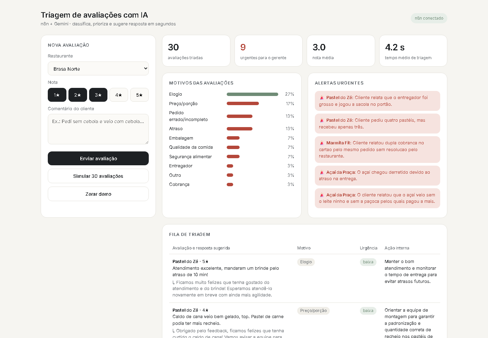

# Triagem de avaliações com IA (n8n + Gemini)

Automação que lê avaliações de clientes de restaurantes, **classifica motivo, sentimento e urgência**, escreve uma resposta sugerida e isola os casos graves para o gerente, tudo em segundos, sem intervenção humana.



## O problema
Um restaurante em app de delivery recebe dezenas de avaliações por dia. As graves (segurança alimentar, cobrança indevida, pedido errado) se misturam com elogios e só são vistas tarde demais, e ninguém sabe dizer **qual é o maior motivo de reclamação**.

## Como funciona

```
Avaliação ──► Webhook (n8n) ──► Normalizar ──► Gemini (JSON Schema) ──► Salvar
                                                                          │
                                                          É urgente? ─────┤
                                                    sim ▼            não ▼
                                             Alerta p/ gerente     Fila normal
Dashboard ◄── Webhook GET /triagem-dados ◄── banco do fluxo
```

Para cada avaliação, a IA devolve:

| Campo | Exemplo |
|---|---|
| `categoria` | `seguranca_alimentar` |
| `sentimento` | `negativo` |
| `urgencia` | `alta` |
| `resumo` | Cliente celíaco recebeu massa comum e passou mal |
| `resposta_sugerida` | Pedimos desculpas pelo erro grave com sua restrição alimentar… |
| `acao_interna` | Revisar o protocolo de preparo de pratos sem glúten |
| `oferecer_cupom` | `true` |

## Resultado do teste
- **30 avaliações simuladas** triadas de ponta a ponta: **30/30**, ~4 s cada
- **9 casos urgentes** isolados automaticamente
- Motivos de reclamação ranqueados no dashboard (atraso, pedido errado, porção…)

## Decisões de engenharia
- **Saída estruturada:** o Gemini responde em JSON com `responseSchema` e categorias fechadas (`enum`), então o dashboard nunca recebe texto solto.
- **Limite de API:** a primeira versão disparava 3 avaliações em paralelo e tomava erro 429. Passei a processar em fila e configurei nova tentativa automática (5×, 4 s).
- **Perda de dados:** em paralelo, execuções simultâneas sobrescreviam o armazenamento do fluxo (metade dos registros sumia). A fila resolveu os dois problemas.
- **Chave fora do código:** a chave vem de variável de ambiente (`$env.GEMINI_API_KEY`); o `workflow.json` não contém segredos.

## Rodar localmente
1. `npm install n8n` (ou `npx n8n`)
2. Copie `start.example.sh`, coloque sua chave do Gemini e rode
3. Importe e publique o fluxo:
   ```
   npx n8n import:workflow --input=workflow.json
   npx n8n publish:workflow --id=Kgjx48hxJ1RRdQ3g
   ```
4. Abra `dashboard.html` no navegador e clique em **Simular 30 avaliações**

## Próximos passos
- Trocar o alerta simulado por Slack/WhatsApp do gerente
- Banco de dados real (Postgres) no lugar do armazenamento do fluxo
- Medir acurácia da IA contra uma amostra classificada à mão

---
Dados 100% simulados, restaurantes fictícios. Feito por Felippe Sicalhone · [portfólio](https://felippe-sicalhone.vercel.app)
